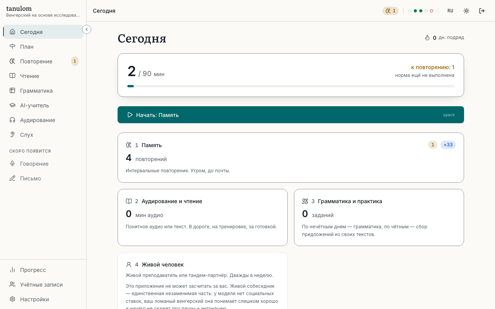
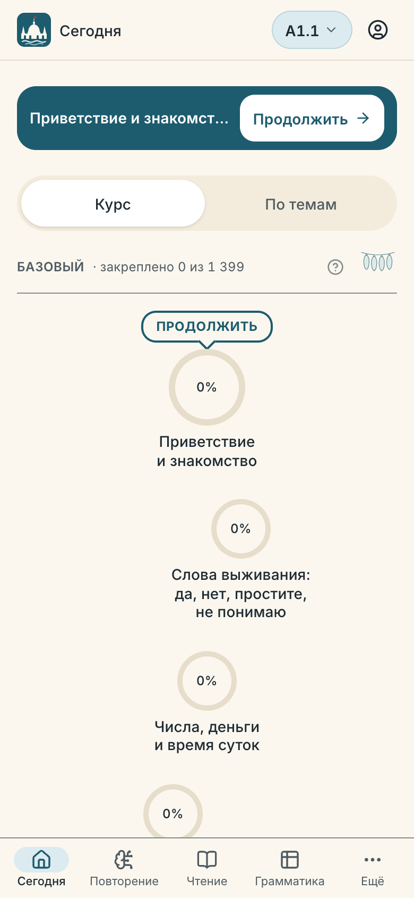
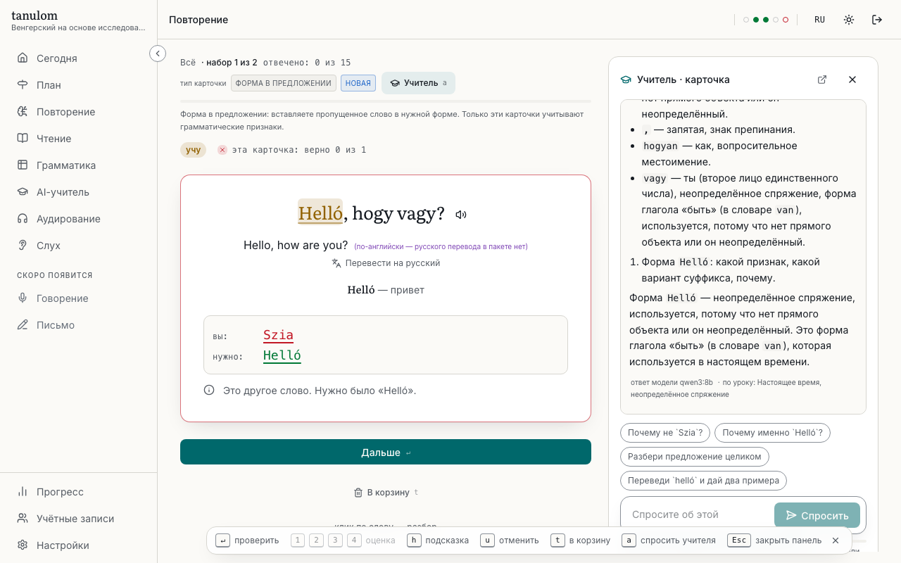
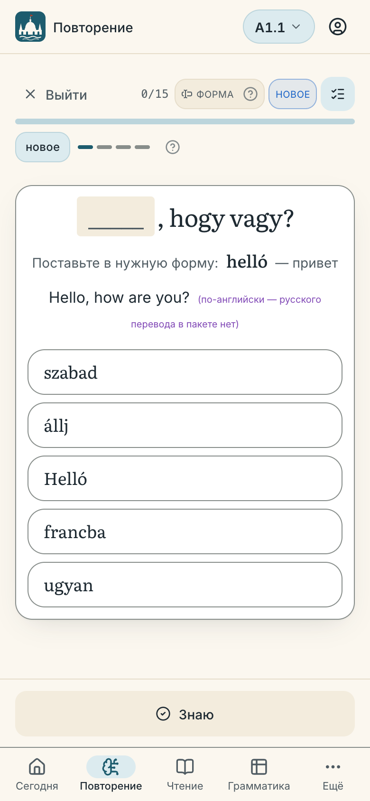
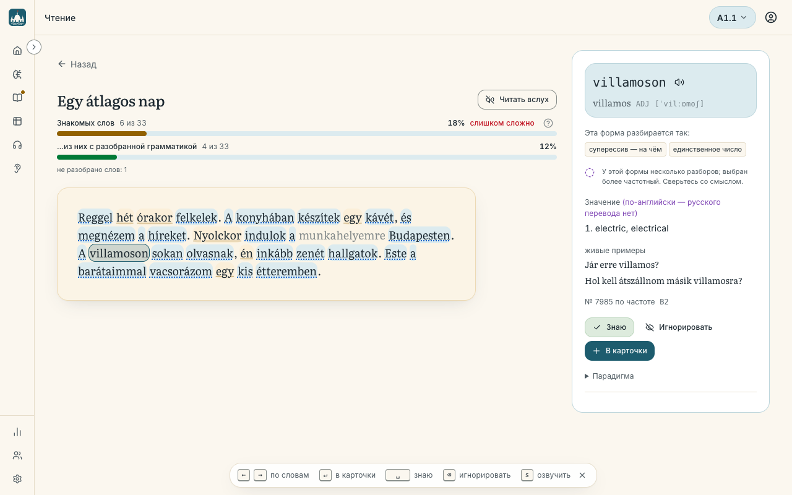
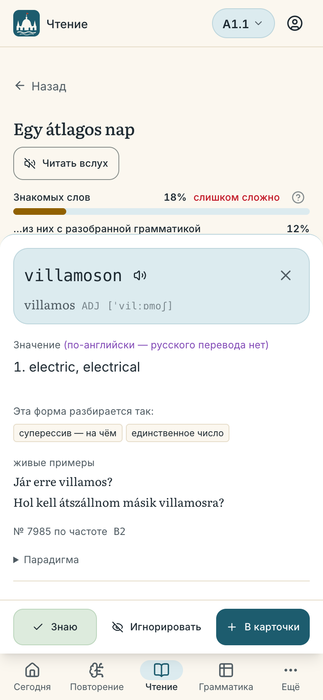
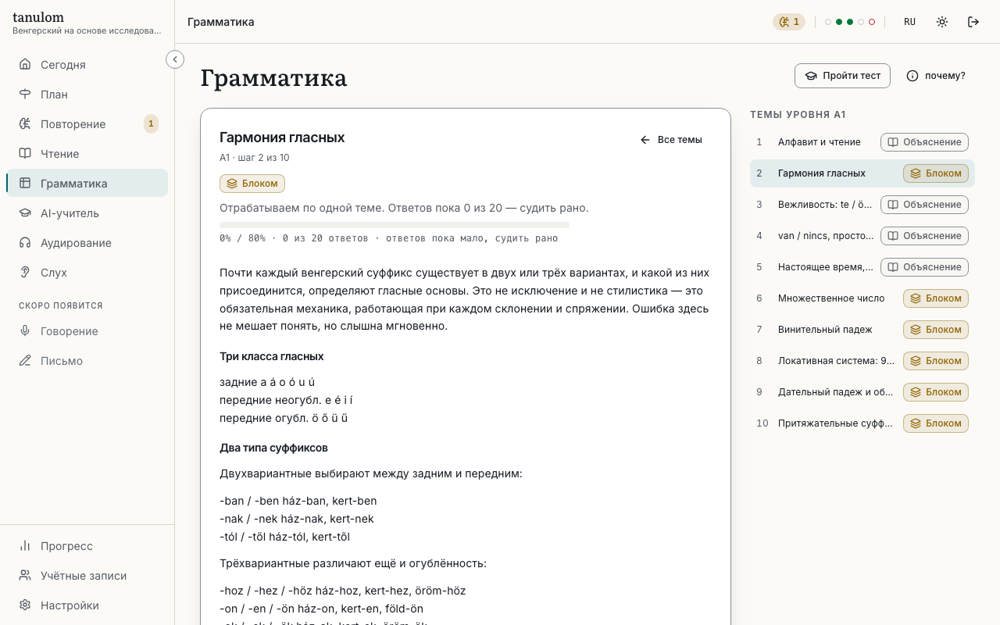
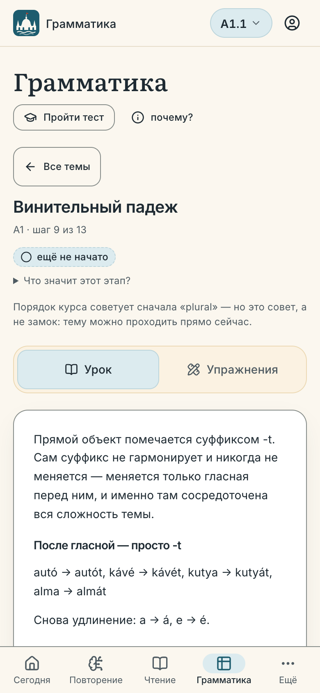
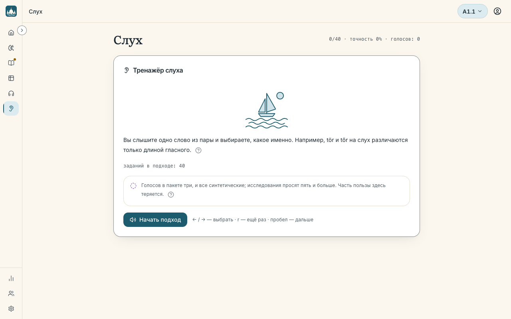
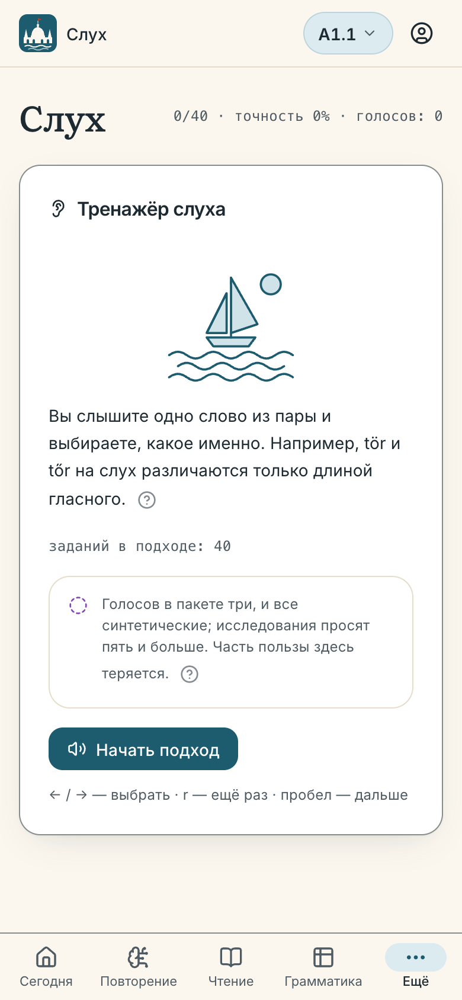

<div align="center">

# tanulom

### Self-hosted Hungarian, built on the evidence — not on vibes.

A learning app that knows the difference between `tanulok` and `tanulom`, and tracks
**every suffix you've met** as a thing you can know, forget and relearn — separately from the
words that carry it.

Build it, open it, create an account and you are learning: the starter dictionary is inside the
binary, and a **guided course in three finite tiers** (basic, intermediate, advanced: 64 units, about 3 100
words, at your own pace) tells you what to do until you no longer need telling.

[](https://github.com/antlko/learn-hungarian-ai/actions/workflows/ci.yml)
[](#how-it-works)
[](LICENSE)
[](docs/LANGPACK.md)

</div>

---

## What it looks like

Light theme, Russian interface (the English one is complete too, ADR-004). Every screen works on a phone.

### Today

The day's four loops, one obligation bar, and a streak that counts obligations met — not points.





### Review

A card after the answer: the verdict, the sentence it came from, and what the word means.





### Reader

Paste any text. Two coverage numbers say how much of it you can read; click a word for its analysis, meaning and real examples.





### Grammar

The lesson comes first; the drill sits behind a button.





### Ear trainer

A real word, two candidates, three voices — perception practice for sounds typing cannot fix.





---

## Why another language app

Anki, LingQ and Migaku all treat a **wordform as an atom**. For Hungarian that is a category
error:

> `házaimban` isn't one thing. It's `ház` + `-a-` + `-im` + `-ban` — one word plus three
> grammatical facts, each learned, forgotten and relearned on its own schedule.

tanulom runs **two independent [FSRS-6](https://github.com/open-spaced-repetition/go-fsrs)
state spaces**: one over lemmas, one over the morphological features the pack teaches. That single decision is
what makes the rest possible:

- **Real `n+1` input.** `elmentem volna` has *zero* unknown words and *two* unknown features.
  Word-counting calls it easy. It isn't.
- **A weakness map for your suffixes.** *"Your inessive is solid. Your conditional sits at 0.41
  retrievability. Your definite conjugation collapses when the object is a demonstrative"* —
  which happens to be the second most common error real learners make.
- **Progress you can't fake.** Vocabulary and morphology are scored separately.

## Built on the research, including where it disagrees with us

Every feature traces to a citation in [`.claude/research/`](.claude/research/README.md) — 20
notes, each with the effect size, the caveats, and a *"what this changes in our code"* section.

Three places where we follow the evidence instead of the intuition:

| Intuition | What the evidence says | What we do |
|---|---|---|
| Interleave grammar from the start — desirable difficulty! | Interleaving is **g = 0.42** overall and **attenuated for rule-based language material**; blocked practice first is *required* below a competence floor ([Brunmair & Richter 2019](https://www.psychologie.uni-wuerzburg.de/fileadmin/06020400/2019/Brunmair_Richter_in_press__2019_META-ANALYSIS_OF_INTERLEAVED_LEARNING.pdf); [Hwang 2025](https://onlinelibrary.wiley.com/doi/10.1111/lang.12659)) | Blocked until 80% rolling accuracy, **then** interleaved — and the app tells you why |
| Ear training is a one-and-done fix | HVPT works (**g = 0.92**) but **decays at 1–2 months** ([Uchihara et al. 2025](https://www.cambridge.org/core/journals/studies-in-second-language-acquisition/article/high-variability-phonetic-training-hvpt-a-metaanalysis-of-l2-perceptual-training-studies/6ABB8C1F32D88D53EA8D05A4565E76F6)) | No contrast is ever "complete" — they come back on schedule, forever |
| Just tell the learner the right answer | Feedback that makes you **produce** the repair beats being handed it ([Li 2010](https://onlinelibrary.wiley.com/doi/abs/10.1111/j.1467-9922.2010.00561.x)) | Locate → hint → reveal, and the reveal is gated server-side until you've tried |

Full map: [`docs/PEDAGOGY.md`](docs/PEDAGOGY.md).

## What it is, in five lines

1. A **Hungarian trainer you host yourself**: one static Go binary (or one Docker container)
   serving a web app. Your data is a directory you own. No cloud, no telemetry.
2. It **teaches in a path**: Today shows your estimated level, the one next thing to do and a
   roadmap of the 24-unit course. Then the course ends and hands you real Hungarian to read.
3. It **reviews with FSRS**, tracking words *and* grammar facts (suffixes) separately.
4. It reads, listens and drills: a reader for your own texts, ready-made reading sets, ear
   training, grammar lessons with exercises, and an optional AI tutor.
5. It **works on a phone** (bottom tabs, touch-sized review) and in Russian or English.

Everything the app does, in plain words: **[docs/FEATURES.md](docs/FEATURES.md)**.

## Quick start

Pick one. All four give you the same app on **http://localhost:8012**; the first page creates the
administrator account (password of at least ten characters) and asks for your interface and gloss
language. **Nothing else needs to be downloaded** — see
[the big-dictionary question](#do-i-need-the-big-dictionary-the-40-minute-thing) below.

### A. Docker, built from this repository (works today)

```bash
git clone https://github.com/antlko/learn-hungarian-ai.git
cd learn-hungarian-ai
docker build -t tanulom .          # builds the web app, then the static binary
docker run -d --name tanulom -p 8012:8012 -v tanulom-data:/data \
  --restart unless-stopped tanulom
```

Want components installed from inside the app (no sidecars)? Build the Python-carrying variant
instead (the published `:latest` already has it): `docker build --target full -t tanulom:full .` and run `tanulom:full`
([which to pick](docs/SELFHOSTING.md#quick-start)).

Keep `--restart unless-stopped`: the in-app **Restart** button (used after installing the full
dictionary) only works when something will bring the container back
([self-hosting](docs/SELFHOSTING.md#restart-policy-matters)). Set `-e TZ=Europe/Budapest` too, or
your "day" ends at UTC midnight.

### B. Docker Compose — the prebuilt image, no clone needed

Save this as `docker-compose.yml` anywhere and run `docker compose up -d`:

```yaml
services:
  tanulom:
    container_name: tanulom
    image: ghcr.io/antlko/learn-hungarian-ai:latest
    ports:
      - '8012:8012'          # host:container — change only the left number
    volumes:
      - tanulom_data:/data   # database, settings, installed packs, your audio
    environment:
      TZ: Europe/Budapest    # your "day" (streak, new-card budget) ends at local midnight
    restart: unless-stopped

volumes:
  tanulom_data:
```

Open **http://localhost:8012** (or whichever host port you picked, e.g. `'7771:8012'` →
`http://localhost:7771`). Everything the app keeps lives in the one `tanulom_data` volume, so
updating is `docker compose pull && docker compose up -d`; to keep a copy on the host instead of a
named volume, use a bind mount such as `/srv/tanulom:/data` (the container runs as uid 65532, so
`chown 65532 /srv/tanulom` first). Keep `restart: unless-stopped`: the in-app **Restart** button
needs something to bring the container back.

The image is published for `amd64` and `arm64` by
`.github/workflows/docker-publish.yml` whenever a `v*` tag is pushed. If the pull is refused from
another machine, the GHCR package is still private: make it public once in the GitHub UI (or
`docker login ghcr.io`). `:latest` includes Python, so *Settings → Components* can install the
analyser or translator inside the container (`:latest-full` is an alias of it). Prefer the smaller
distroless image without Python? Use `:latest-slim`; switching tag keeps your data and account.

**The repository's own `docker-compose.yml`** (clone, then `cp .env.example .env`) adds the optional
sidecars as profiles — `mt` (sentence translation), `llm` (a local Ollama) — none of which the
app needs. `COMPOSE_PROFILES=` empty runs the core alone; `.env.example` defaults to `mt,llm`.

### C. From source, no Docker

Needs Go 1.26+ and Node 22.18+ or 24.12+ (no C compiler: `CGO_ENABLED=0`).

```bash
make build                     # web app -> embedded -> one static binary at bin/tanulom
./bin/tanulom --data-dir ./data
```

### D. Development

```bash
make dev                       # Go API on :8012 + Vite with hot reload
```

Open **http://localhost:5173**. `make` alone lists every target;
[docs/DEVELOPMENT.md](docs/DEVELOPMENT.md) has the rest.

*What was checked:* the commands above were read against the `Dockerfile`, `Makefile`,
`docker-compose.yml` and the publish workflow. The Docker builds were not run for this
documentation pass.

### Do I need the big dictionary? (the 40-minute thing)

**No.** The binary carries a **starter dictionary** and installs it on first boot. It is a real
pack, not a demo — measured from the embedded file:

| | starter (inside the binary) | full |
|---|---|---|
| lemmas | 5,725 | 35,311 |
| word forms | 587,898 | ~1.98 million |
| example sentences | 12,858 (all Tatoeba, human-written) | ~60,000 |
| Russian glosses (lemmas) | 2,598 | 8,620 |
| the 24-unit course + 12 theme units (1,938 words) | all | all |
| grammar lessons (33 topics), ear-training pairs and clips | all | all |

The full dictionary only **widens lookup**: more rare words found when you click in the reader,
more example sentences. No feature depends on it. (Full-pack figures are from
[docs/LANGPACK.md](docs/LANGPACK.md); starter figures were counted from
`backend/internal/lang/starter/`.)

There are two ways to get it:

1. **Settings → Components → «Установить полный словарь»** (admin). The app downloads a gzipped
   pack, checks it against a SHA-256 pinned in the binary, verifies that every word your cards
   point at still means the same word, and asks for a restart. The pack is the
   Tatoeba-only build (35,311 words, 60,000 sentences, about 62 MB), committed in this repository
   under `langpack/release/`.
   (`langpack.url` / `langpack.sha256` in config override the pin, e.g. for a mirror.)
2. **Build it yourself: `make langpack`.** Not for the faint-hearted: it fetches about **2 GB of
   OpenSubtitles and 580 MB of Wiktionary**, needs a lot of scratch space and Python 3.11, and
   **its running time has not been measured** (the docs say "hours"). Copy the resulting
   `data/langpack-hu-v1.sqlite` into the data volume and restart.

The **"~40 minutes"** in the Makefile belongs to a different target, `make subtitles`, which adds
conversational sentences to a pack you already built. It is the maintainer's estimate, not a
measurement we repeated. If you never built a full pack you never need it.

## Optional components

The core is complete without any of these. Each is probed at runtime; a feature whose service is
missing is switched off with the reason on screen. Settings → Components (admin) shows the state
of each. The app cannot start containers for you (it has no Docker access, on purpose), so the
start command is always yours.

| Component | What it is | What it gives you | Cost |
|---|---|---|---|
| **Translator** (MT) | NLLB-200-distilled-600M, a small translation model that runs on your CPU | a **labelled** machine crib («машинный перевод, модель …») under Hungarian sentences in the reader, so you need not paste text into someone else's chat. Never used as a card's answer. | `docker compose --profile mt up -d`; ~2.4 GB downloaded on first build, ~600 MB kept, 200–400 MB RAM. Weights are CC-BY-NC. |
| **Tutor model** (LLM) | any OpenAI-compatible endpoint | the grammar tutor and AI dictionary entries. `qwen3:8b` is recommended; a 1.7B model cannot do the job ([docs/TUTOR.md](docs/TUTOR.md)). | Local Ollama via `--profile llm` plus `ollama pull qwen3:8b` (~5 GB, a step nobody does for you), or a hosted API. |
| **Speech** | text-to-speech / recognition services | nothing yet: `services/tts` and `services/asr` are **not built**. Audio today is your browser's own voices (the `device` provider) plus the ear trainer's clips already in the binary. | n/a |

Setup details, ports and memory sizing: [docs/SELFHOSTING.md](docs/SELFHOSTING.md).

## What's in it

The short version; [docs/FEATURES.md](docs/FEATURES.md) is the real list.

- **Today** — your estimated level and how much of ordinary text you would understand, the
  one next action, and a roadmap of the course.
- **Review** — FSRS-6 cards in five directions (recognise, produce, listen, cloze, spell) with a
  suffix-level diff, dealt in sets, with a «Как это работает» explainer.
- **Words** — every word you have, by stage: учится → повторяется → закреплено.
- **Grammar** — a path of topics; lesson first, then exercises, gated in numbers you can see.
- **Read / Library** — paste a URL, `.srt` or `.epub`, or import a ready-made reading set; mine
  words into your deck.
- **Listen and Ear** — graded listening and multi-talker minimal-pair training.
- **Tutor** — a grammar chat in your language (needs a model).
- **Progress** — estimated level, text coverage, the lemma curve, activity calendar, suffix heatmap.
- **Yours** — one data directory; export or import a full profile.

Not built: speaking practice with pronunciation feedback and a writing corrector.

## How it works

One static Go binary embeds the built Vue app and serves both the API and the UI.

- **Backend** — Go with [Fiber v3](https://gofiber.io), pure-Go SQLite
  ([`modernc.org/sqlite`](https://pkg.go.dev/modernc.org/sqlite), no CGO) with
  [goose](https://github.com/pressly/goose) migrations applied on start,
  [FSRS-6](https://github.com/open-spaced-repetition/go-fsrs), bcrypt + cookie sessions,
  structured `slog`.
- **Frontend** — Vue 3 + TypeScript, Pinia, Tailwind v4, hand-rolled primitives in the shadcn
  idiom, `vue-i18n` (RU + EN). Offline review is planned, not shipped.
- **Language pack** — a versioned read-only SQLite file built offline from Wiktionary, Tatoeba
  and frequency data by a Python pipeline with its own vowel-harmony and inflection engines. The
  runtime does indexed lookups and needs **no Python at all**. [`docs/LANGPACK.md`](docs/LANGPACK.md).

Tiny, fast, `amd64` + `arm64` — it runs on a NAS or a Raspberry Pi.

## Honest about its limits

Stated in the app, not buried here: FSRS's efficiency figure comes from simulation, not a trial;
per-user FSRS optimisation isn't in v1.0; the 95/98% coverage thresholds were derived for
English; the level shown is an estimate (it can be off by a sublevel or two); speech recognition
is not built; and the ear trainer ships **three** synthetic voices where the research asks for
five or more, because three is how many freely-licensed Hungarian voices exist. Not every grammar
topic has exercises (13 of 33 do); the others say so and teach by explanation. Full list:
[docs/FEATURES.md](docs/FEATURES.md#known-limits).

And the big one: **this app cannot replace a teacher.** The one loop it refuses to tick off for
you is the one with a human in it.

## Documentation

[**Features**](docs/FEATURES.md) · [Self-hosting](docs/SELFHOSTING.md) ·
[Architecture](docs/ARCHITECTURE.md) · [Pedagogy](docs/PEDAGOGY.md) ·
[Language pack](docs/LANGPACK.md) · [UX](docs/UX.md) · [API](docs/API.md) · [Tutor](docs/TUTOR.md) ·
[Configuration](docs/CONFIGURATION.md) · [Development](docs/DEVELOPMENT.md) ·
[Research library](.claude/research/README.md) · [Decisions](.claude/DECISIONS.md) ·
[Changelog](CHANGELOG.md)

## Licence

Code: [MIT](LICENSE). The language pack is derived from CC BY-SA sources (Wiktionary, Tatoeba,
Hungarian Webcorpus) and is released under **CC BY-SA 4.0** — see
[`langpack/LICENSES.md`](langpack/LICENSES.md) for the full attribution ledger.
